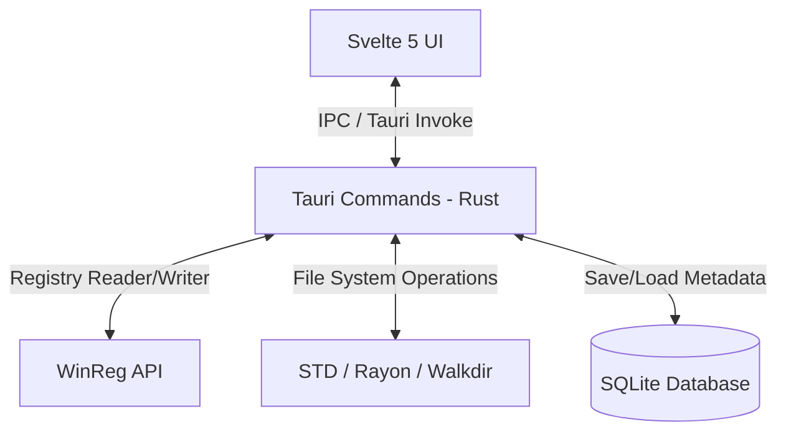

# 📐 PurgeKit Technical Architecture

This document describes the design architecture, project structure, database schema, and communication protocols of **PurgeKit**.

---

## 🏗️ Architectural Overview

PurgeKit is built as a **Tauri v2** application. It decouples high-privilege, low-level OS operations (Registry access, file deletion, process creation) into a **Rust backend** while displaying a modern, responsive user interface in a **Svelte 5 frontend**.



---

## 📂 Project Structure & Module Breakdown

### 🦀 Rust Backend (`src-tauri/`)

* **`src/main.rs`**: Application entry point. Parses command-line interfaces (CLI mode) using `clap` and bootstraps the Tauri application.
* **`src/lib.rs`**: Initializes Tauri plugins, configures SQLite database tables, registers Tauri commands, and binds background process lifecycles.
* **`src/db.rs`**: Handles connections to `purgekit.db` (SQLite). Stores and queries snapshot records.
* **`src/snapshot_engine.rs`**: Implements system baseline scanning, JSON compression, and the diff engine.
* **`src/commands.rs`**: Binds Tauri IPC invocations to Rust functions. Handles thread-spawning, validation and background task processing.
* **`src/scanner/`** (Low-level scanner modules):
  - **`inventory.rs`**: Merges registry, Store, CLI, toolchain and portable entries into one inventory with icons and install dates.
  - **`registry.rs`**: Queries uninstall registry keys; resolves icons, install locations and install dates.
  - **`uwp.rs`**: Scans Store packages and resolves manifest logos/executables.
  - **`cli_dev.rs`**: Detects and cleans developer caches and global CLI packages.
  - **`dev_extensions.rs`**: Lists editor extensions with their executable paths.
  - **`remnants.rs`**: Scans filesystem/registry leftovers with name-token matching.
  - **`msi.rs` / `com_purger.rs`**: MSI product and COM/typelib orphan scans.
  - **`path_cleaner.rs`**: Sanitizes Windows PATH variables and propagates changes with `WM_SETTINGCHANGE`.
  - **`project_sweeper.rs`**: Traverses workspace roots for build artifacts and enforces scan-bound deletion.
  - **`startup_manager.rs`**: Registry Run keys, Startup folders, scheduled tasks, icons and stale-target detection.
  - **`disk_scan.rs` / `csv_scan.rs`**: Traversal and CSV/TSV disk scans, file index, duplicates and export.
  - **`mft_scan.rs` / `volume_reader.rs`**: Live NTFS MFT reads, `.pkmft` dumps, WizTree `.MFT` import and aligned volume I/O.
  - **`derived_cache.rs`**: Persistent derived icon/location/size/date cache.
  - **`wsl_shrinker.rs`**: WSL distribution discovery and DiskPart compaction.
  - **`toolchain_sweeper.rs`**: Rustup/NVM/FNM version discovery and removal.

### ⚡ Frontend Svelte UI (`src/`)

* **`src/routes/+page.svelte`**: Main application container. Manages the active tab state and renders tab views.
* **`src/lib/components/`** (UI Views):
  - **`Sidebar.svelte`**: Hover-expanding sidebar menu containing all modules.
  - **`AppsTab.svelte`**: Renders standard and store apps in a responsive table. Manages uninstallation and displays the remnant cleaning overlay.
  - **`DevToolsTab.svelte`**: Contains tabs for Developer Caches, Global Packages, and Runtimes.
  - **`ProjectSweeperTab.svelte`**: Displays configured scan paths, preset filters, and traverse results.
  - **`WslShrinkerTab.svelte`**: Lists WSL distributions, disk sizes, sparse state, and renders the live DiskPart terminal logs view.
  - **`SnapshotsTab.svelte`**: Step-by-step workflow for taking system snapshots and viewing diff lists.
  - **`PathCleanerTab.svelte`**: Renders PATH entries, broken paths, duplicates, and repair controls.
  - **`StartupTab.svelte`**: Startup entries with icons, stale-target warnings and enable/delete actions.
  - **`DiskSpaceTab.svelte`**: Disk treemap, MFT scans/dumps, file/type/duplicate views and exports.
  - **`SettingsTab.svelte`**: Theme/accessibility, backup policy, cache controls and Administrator status.

---

## 🗄️ Database Schema (SQLite)

PurgeKit maintains a local SQLite database file `purgekit.db` inside the `%AppData%\PurgeKit\` folder to store snapshot metadata.

### `snapshots` Table
```sql
CREATE TABLE IF NOT EXISTS snapshots (
    id TEXT PRIMARY KEY,
    name TEXT NOT NULL,
    created_at TEXT NOT NULL,
    data_file_path TEXT NOT NULL,
    reg_count INTEGER NOT NULL,
    file_count INTEGER NOT NULL
);
```

---

## 💬 Tauri IPC Commands

The frontend uses Tauri `invoke` for all backend operations. Commands are grouped below; argument names and return types are defined in [`src-tauri/src/commands.rs`](../src-tauri/src/commands.rs).

| Area | Commands |
|---|---|
| Apps & uninstall | `get_installed_apps`, `get_app_remnants`, `purge_remnants`, `remove_uninstall_entry`, `force_remove_app`, `run_uninstall_command`, `run_app_command`, `run_bulk_silent_uninstall` |
| Developer tools | `get_dev_tools`, `clean_dev_tool_cache`, `get_dev_extensions`, `get_global_cli_packages`, `uninstall_global_cli_package`, `get_cli_package_bin_names`, `get_cli_package_remnants` |
| Disk & MFT | `scan_disk_space`, `scan_disk_space_multi`, `cancel_disk_scan`, `search_disk_files`, `export_disk_files_csv`, `export_disk_file_types_csv`, `import_disk_csv`, `list_disk_drives`, `dump_mft_scan`, `list_mft_dumps`, `load_mft_dump`, `load_wiztree_mft`, `get_mft_dump_dir` |
| Startup | `get_startup_items`, `set_startup_item_status`, `delete_startup_item` |
| Snapshots & safety | `take_snapshot`, `list_snapshots`, `delete_snapshot`, `compare_snapshots`, `list_quarantine_items`, `restore_quarantine_item`, `delete_quarantine_item`, `start_install_tracking`, `stop_install_tracking`, `get_pending_reboot_items`, `get_derived_cache_summary`, `clear_derived_cache` |
| Settings & elevation | `get_settings`, `save_settings`, `check_is_admin`, `restart_as_admin`, `check_directory_exists` |
| Cleaners | `get_path_entries`, `save_path_entries`, `scan_project_directories`, `delete_project_directories`, `get_wsl_distros`, `compact_wsl_distro`, `set_wsl_distro_sparse_mode`, `get_toolchain_versions`, `delete_toolchain_version` |

All commands validate paths, registry keys and process inputs in the Rust layer; the UI is not the security boundary.

---

## 📡 Live Log Streaming Protocols (IPC Events)

For long-running tasks, PurgeKit uses Tauri's event-emitter protocol instead of standard request-response loops. This ensures real-time feedback in the Svelte UI:

1. **WSL Disk Compaction**: Spawns a background task running DiskPart. Outflow lines are caught by Rust and emitted via Tauri event `wsl-compact-progress` with payload:
   ```json
   { "phase": "compacting" | "completed" | "error", "message": "DiskPart log string..." }
   ```
2. **Project Sweeper**: As directory traversal runs in a background thread, progress is throttled and emitted via `project-scan-progress` to show the directory currently being searched:
   ```json
   { "current_dir": "D:\\Code\\...", "folders_found": 12, "total_size_bytes": 1024000 }
   ```
3. **Bulk Uninstallation**: Spawns sequential app uninstallations, emitting status logs to the frontend via `bulk-uninstall-progress`:
   ```json
   { "app_id": "...", "app_name": "...", "phase": "uninstalling" | "leftovers", "current": 1, "total": 5, "message": "Uninstalling..." }
   ```
